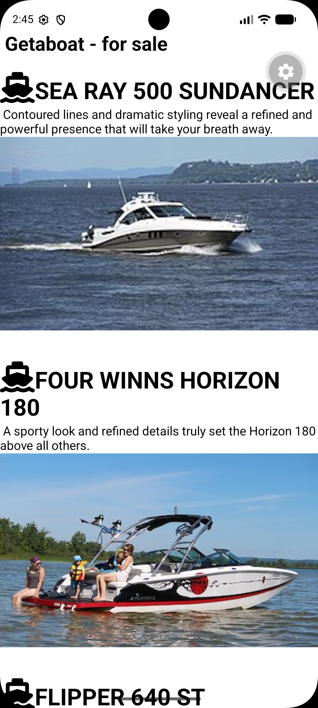
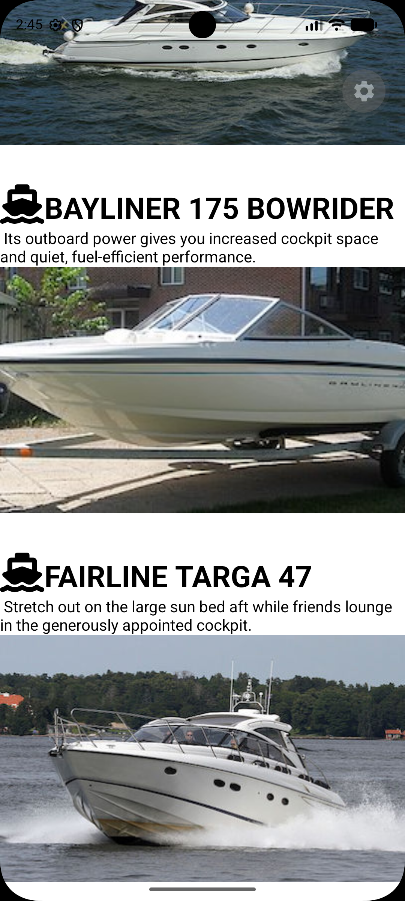
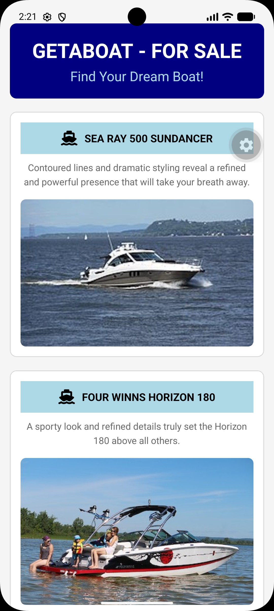
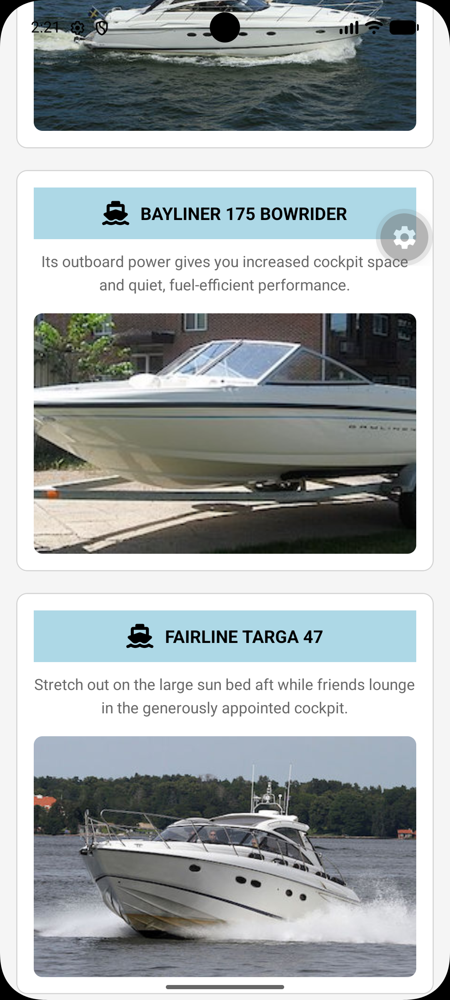

Boat For Sale 

This app is a boat catalogue mobile application developed using React Native. 
This app allow users to browse different boats available for sales.
The app displays the boats with their names, descriptions, and images. 
It uses StyleSheet and Flexbox to create a neat, organised, and user-friendly layout, making it easier for users to view and compare different boat models.

ScreenShots of App BEFORE applying Stylesheet changes
Screenshots:

ScreenShots of App AFTER applying Stylesheet changes
Screenshots:

Link to Demo Video with audible narration explaining styling changes with code reference
Demo Video Link: